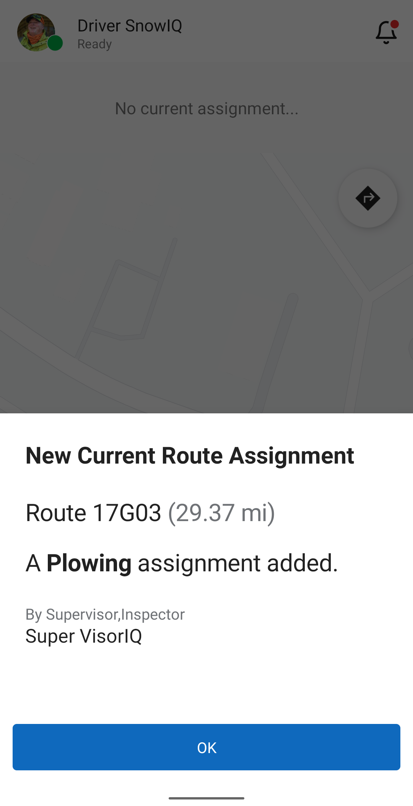
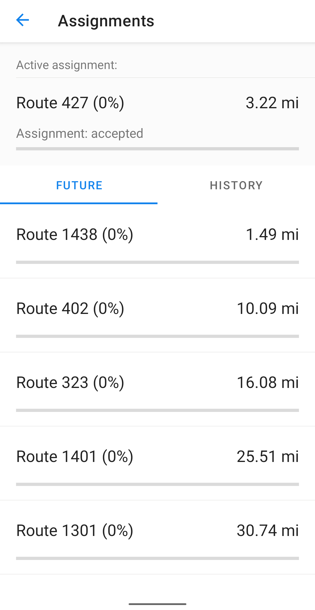
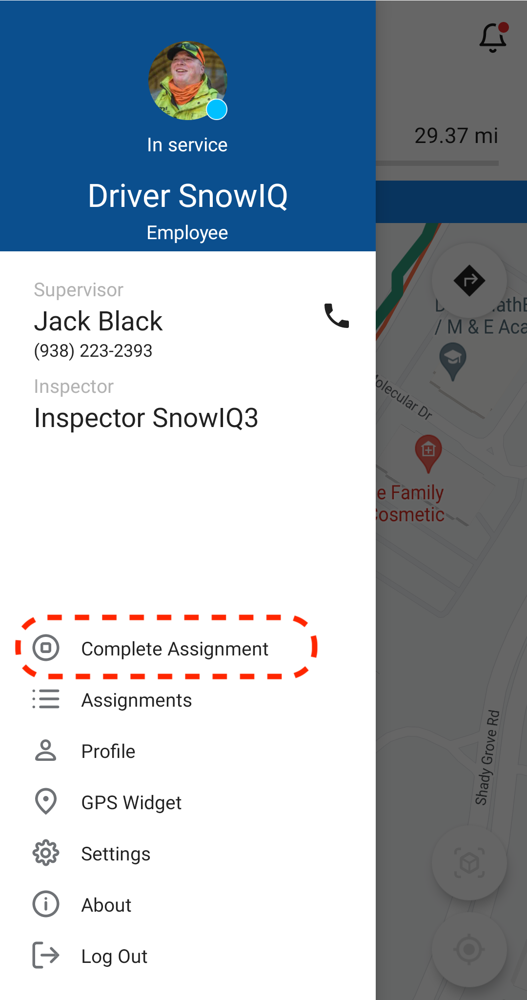
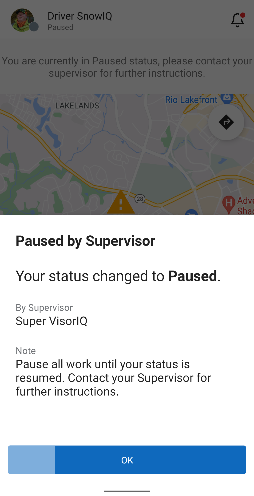

# Driver's Activity

## Assignment Types

Supervisors send work to Drivers as Assignments. Every Assignment has an Activity (for example, Plowing or Salting) and a note from the Supervisor with any additional instructions. There are four types of Assignments:

### Route Assignment

A Route assignment asks the Driver to work an entire route using the specified Activity. Progress is tracked automatically from the Driver's GPS location: the app draws breadcrumbs along the completed parts of the route and shows the percentage of completion.

Routes have one of two priorities:

* **Emergency** - Emergency routes are worked first. On the map, they are shown as emergency (red) road segments, or a combination of emergency (red) and primary (blue) road segments.
* **Residential** - Residential routes have a lower priority and are worked after Emergency routes are completed. On the map, they are shown as neighborhood (orange) road segments, or a combination of neighborhood (orange) and primary (blue) road segments.

A Route assignment can be single-pass or multi-pass. See [Completing a Multi-Pass Assignment](#completing-a-multi-pass-assignment) below.

### Staging Location Assignment

A Staging Location assignment sends the Driver to a location on the map to wait, ready to start work. Supervisors typically use it before the active phase of an event begins (usually during the Monitoring phase), so that Drivers are already in position when plowing or salting starts. Navigate to the staging location and check the assignment note for instructions, such as where exactly to park or wait.

### Address Assignment

An Address assignment asks the Driver to perform the specified Activity at a specific address, for example, to clear a single street or entrance. Navigate to the address and complete the work there.

### Ticket Assignment

A Ticket assignment is an Address assignment associated with an MC311 ticket: a service request reported by a resident, such as a street that still needs to be plowed. The Driver works it the same way as an Address assignment. When the Driver completes a Ticket assignment, the related ticket is closed in all SNOWiQ applications.

**Note:** A Supervisor can mark any type of Assignment as a priority task. Priority tasks are placed at the top of the Driver's queue of Future assignments.

## Working on Assignments

### Accepting an Assignment

When a Supervisor assigns a route, ticket, address-specific, or staging location assignment, the Driver will receive a notification as pictured below. Select 'Ok' and do the following:

- Check the assignment type (see [Assignment Types](#assignment-types) above) and read the Supervisor's note for any instructions.
- Get directions to the location of the assignment by selecting the Navigate button in the app (the blue arrow icon in the top right corner). This will 
 open Google Maps to provide directions. 
- Once the system begins tracking a driver's assignment per the Driver's GPS location, the system will change the status of the Active Assignment to 'Started' in the status bar and begin displaying breadcrumbs that indicate the route being worked on. 
- Alternatively, the Driver can manually go to the Navigation menu and select 'Start Assignment'.

### Assignments Menu

The driver app has an Assignments menu, which contains a list of current, future and historical assignments.

To display the Assignments menu, select Assignments in the main menu.

### Completing Assignments

A Driver can complete their Active Assignment by selecting the Navigation menu and then selecting 'Complete Assignment', as shown below.

This removes the assignment from the Status bar and also moves it from Active Assignments to the History tab in the 'Assignments' panel in the Operations menu. If the Driver has another Assignment in the queue (which would be displayed in the 'Future' tab in the 'Assignments' panel), then the Driver will receive a new assignment notification and can then follow the process described in the [Accepting an Assignment](#accepting-an-assignment) section above.

### Completing a Multi-Pass Assignment

Some routes need more than one pass to be fully cleared. If you receive an assignment with Multi-Pass switched on, you will be notified. Work the route as usual. The start time of each pass is recorded automatically.

When you finish a pass, select 'Complete Pass' in the Navigation menu. Then:

* The assignment status changes to 'Completed Pending', and the status bar asks you to wait for instructions.
* Your breadcrumbs for the pass are cleared from the map, and the assignment details are hidden while you wait.
* **Every Driver on the same route is put on hold**, even Drivers who have not started yet. You stay on the route and will not get other work until a decision is made.

An Inspector or Supervisor then decides whether the route needs another pass:

* **Another pass is needed:** You get an 'Another Pass Requested' notification that shows who requested it. Your assignment goes back to 'Accepted'. Start working the route again, and select 'Complete Pass' when you finish. These steps repeat for every pass.
* **The route is done:** The assignment moves from your Active Assignments to the 'History' tab in the 'Assignments' panel. If you have another assignment in your queue, you move on to it. If not, your status changes to 'Ready' for new work.

### Pause/Resume an Assignment

When a Supervisor pauses an Assignment, the Driver will receive the following notification:

The Assignment stays on hold until the Supervisor resumes it. Once resumed, the Driver is notified and can continue working on the Assignment.

