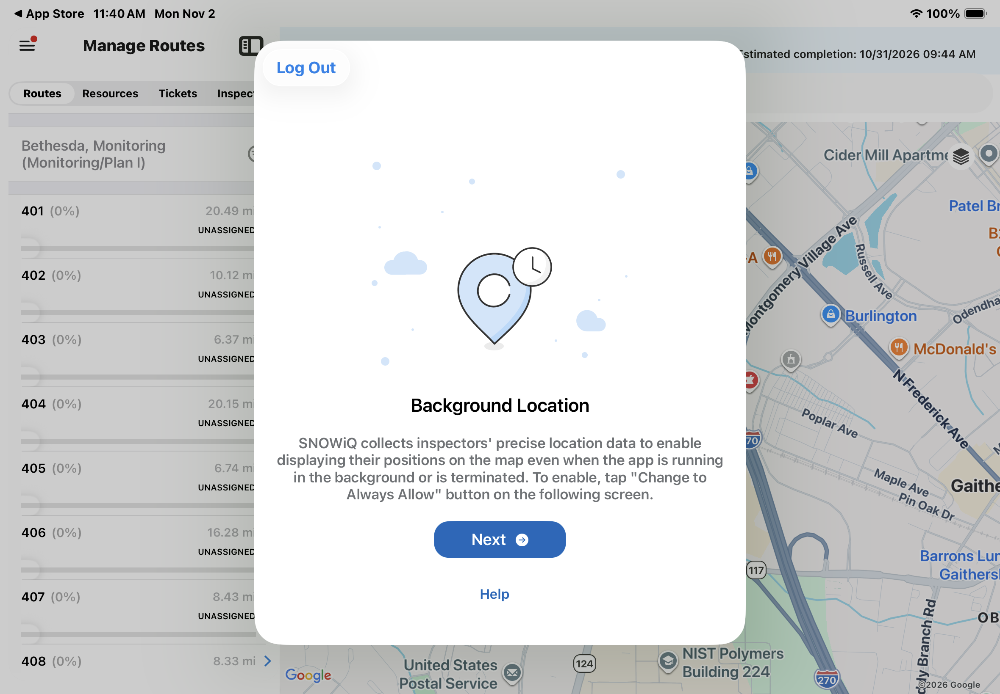
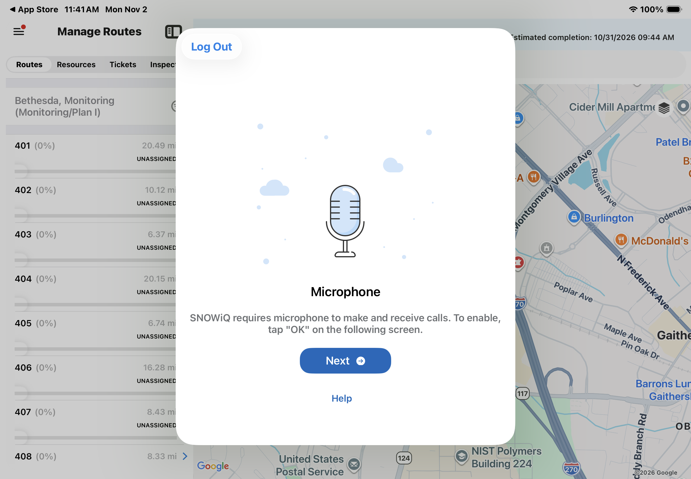

<section id="Get-Started" markdown="1">
# Get Started

After downloading and installing the Supervisor App (see the [Supervisor App](sa-overview.html) page for download links), a user must log in and allow the permissions the app needs before using it.

<section id="Log-In" markdown="1">
## Log In

Open the app and log in with the assigned username and password, as described in [Login and Navigation](sa-login-and-navigation.html#Login).
</section>

<section id="Permissions" markdown="1">
## Permissions

After the first login, the app asks the user to allow access to several device features. For each permission, the app first displays an explanation screen. Select **Next** on that screen to open the device's system prompt, then allow access as described below.

The Supervisor App requires the following permissions:

| Permission | Setting to choose | Why it is needed |
|:-----------|:------------------|:-----------------|
| Location (Precise) | Precise: On, **Allow While Using App** | Tracks the location of SNOWiQ personnel and displays the user's position on the map for location-based workflows. |
| Location (Background) | **Change to Always Allow** | Keeps the user's location up to date on the map even when the app is running in the background or is closed. |
| Camera | Allow | Required by the app's features that use the camera. |
| Microphone | Allow | Required to make and receive calls in the app. |
| Notifications | Allow | Required to receive alerts from SNOWiQ, such as Pass Completion Notices and phase updates. |

**Note:** All of these permissions are required for the Supervisor App to work correctly. If a permission was denied by mistake, it can be changed later in the iPad **Settings** app under **SNOWiQ Supervisor**.

<section id="Location" markdown="1">
### Location

SNOWiQ uses precise location to track the position of SNOWiQ personnel (Supervisors and Inspectors) for location-based workflows, and to display the user's position on the map.

When the system location prompt appears:

* Make sure **Precise** is set to **On**
* Select **Allow While Using App**
</section>

<section id="Background-Location" markdown="1">
### Background Location

To keep Inspectors' and Supervisors' positions on the map up to date, SNOWiQ also needs location access when the app is running in the background or has been closed.

* On the 'Background Location' screen, select **Next**
* On the following system prompt, select **Change to Always Allow**

</section>

<section id="Camera" markdown="1">
### Camera

On the 'Camera' screen, select **Next**, then allow camera access on the following system prompt.
</section>

<section id="Microphone" markdown="1">
### Microphone

SNOWiQ requires the microphone to make and receive calls.

* On the 'Microphone' screen, select **Next**
* Select **OK** on the following system prompt

</section>

<section id="Notifications" markdown="1">
### Notifications

On the 'Notifications' screen, select **Next**, then allow notifications on the following system prompt.
</section>

Each permission screen also has a **Help** link, and a **Log Out** button in the top left corner.

After all permissions are allowed, the app displays the Map Monitoring view. See [Login and Navigation](sa-login-and-navigation.html#Navigation) for an overview of the main screen.
</section>
</section>
