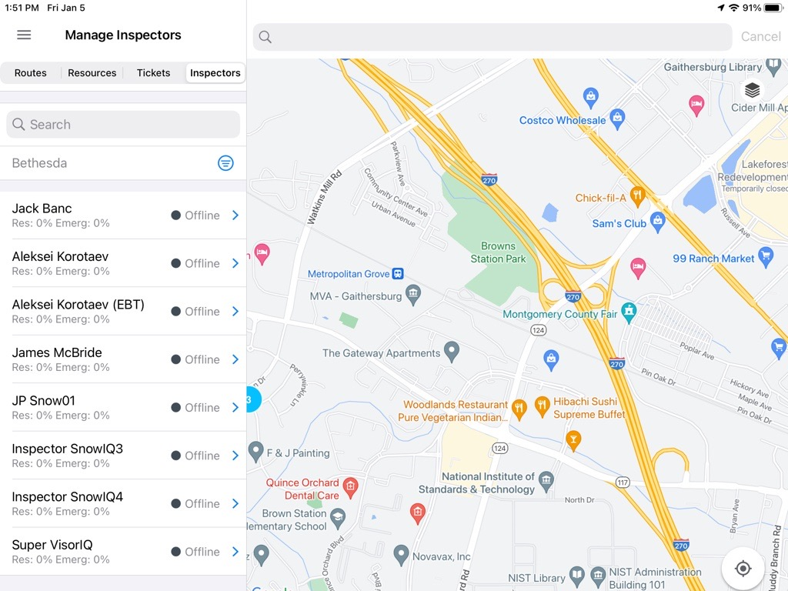
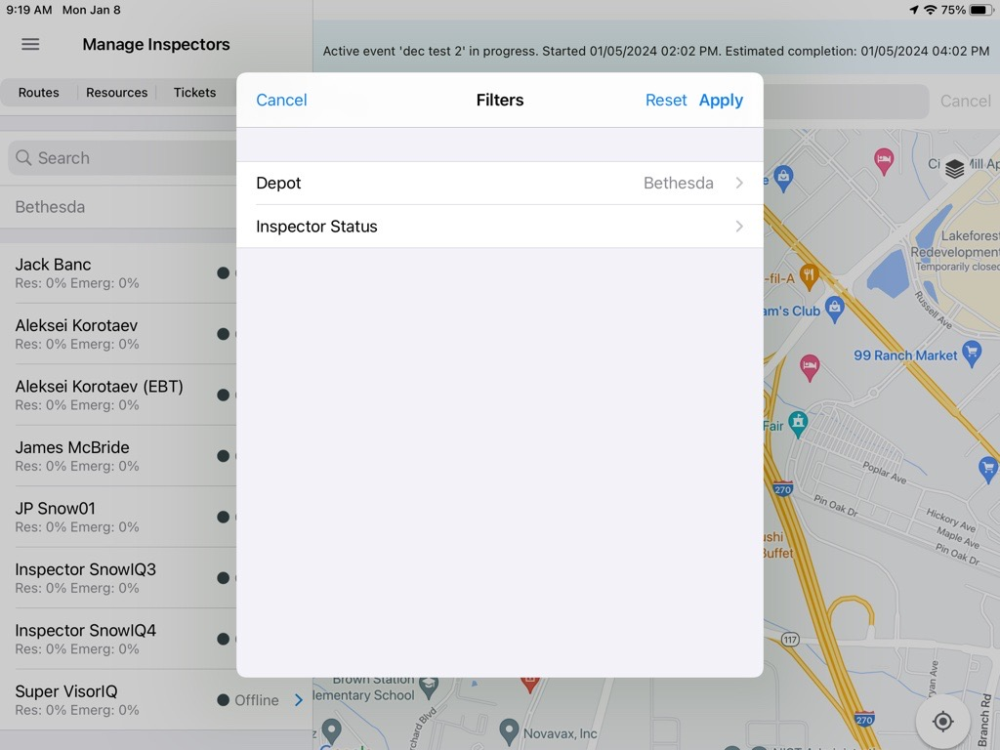
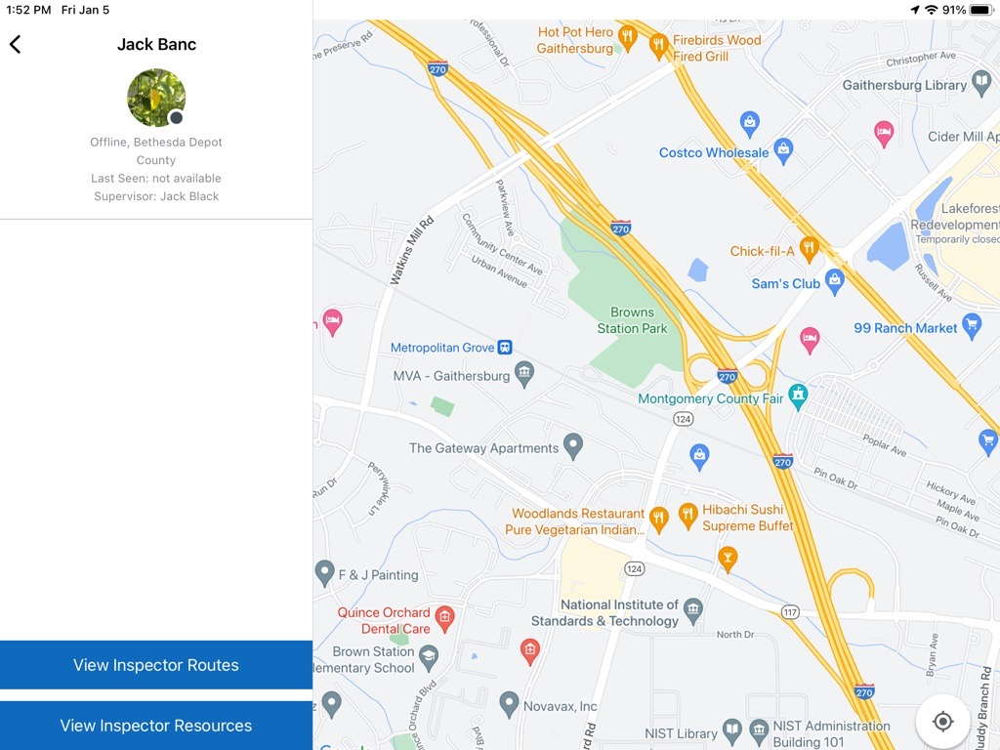

<section id="Inspectors-Tab-View" markdown="1">
# Inspectors Tab View

The panel on the left has four tabs: Routes, Resources, Tickets, and Inspectors. Select the Inspectors tab to display the Inspectors panel, as seen below.

The Inspectors panel displays a list of inspectors with their statuses and the percentage of completion of their active Residential and Emergency assignments.

<section id="Inspector-Filters" markdown="1">
## Inspector Filters

Filters are available above the list: by Depot and by Inspector Status. Use the filters to narrow down the inspector list.

<section id="Depot" markdown="1">
### Depot

The Depot filter defaults to the depot the user is assigned to, and only the inspectors associated with that depot are displayed.
</section>

<section id="Inspector-Status" markdown="1">
### Inspector Status

The Inspector Status filter allows users to filter the list by Online or Offline status.
</section>
</section>

<section id="Inspector-Details" markdown="1">
## Inspector Details

Selecting an inspector from the list displays the 'Inspector Details' panel on the left. The panel includes the Inspector's name, status, depot, last seen time, and Supervisor information. From the 'Inspector Details' panel, a user can:

* Select 'View Inspector Routes' to navigate to the Inspector's routes and review their near-real time progress
* Select 'View Inspector Resources' to view the Inspector's resources

</section>
</section>
