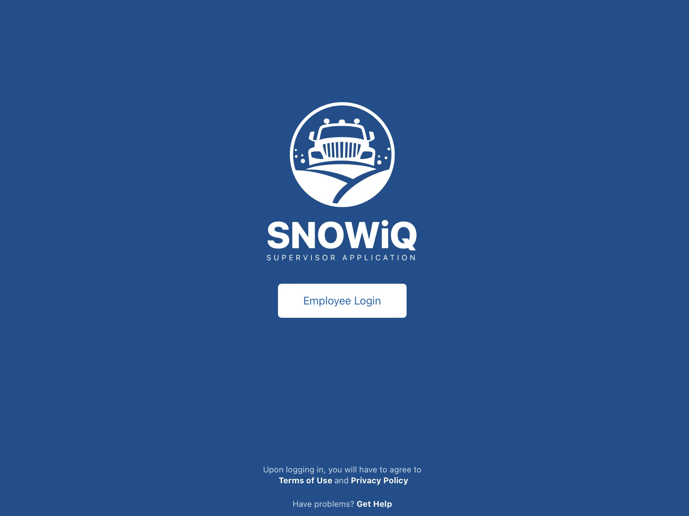
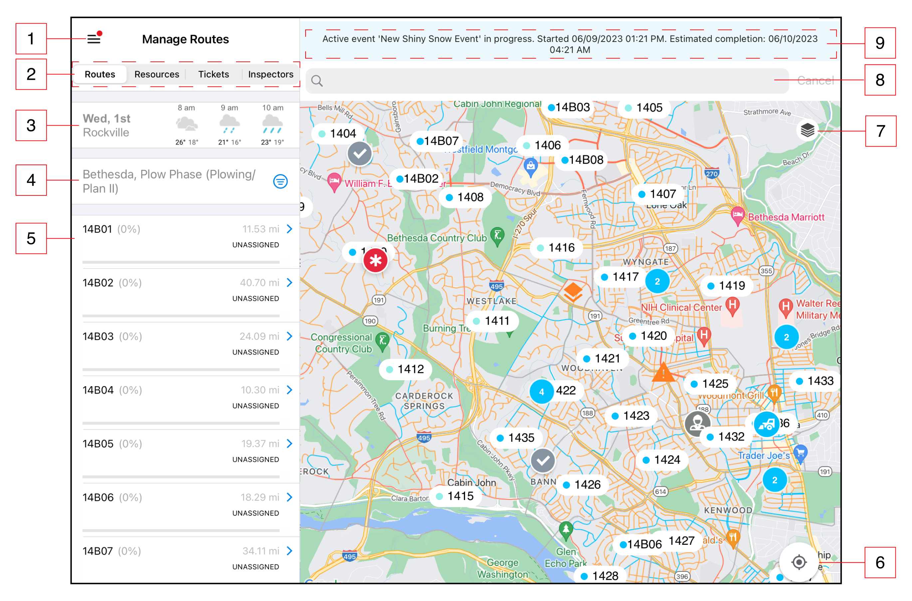
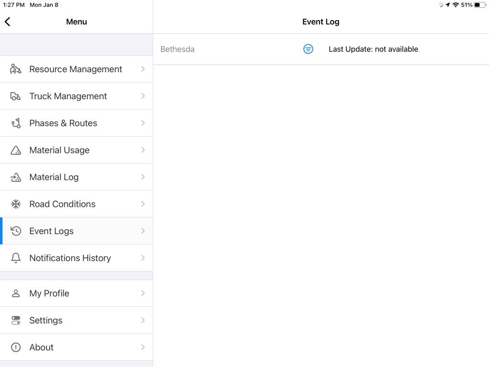
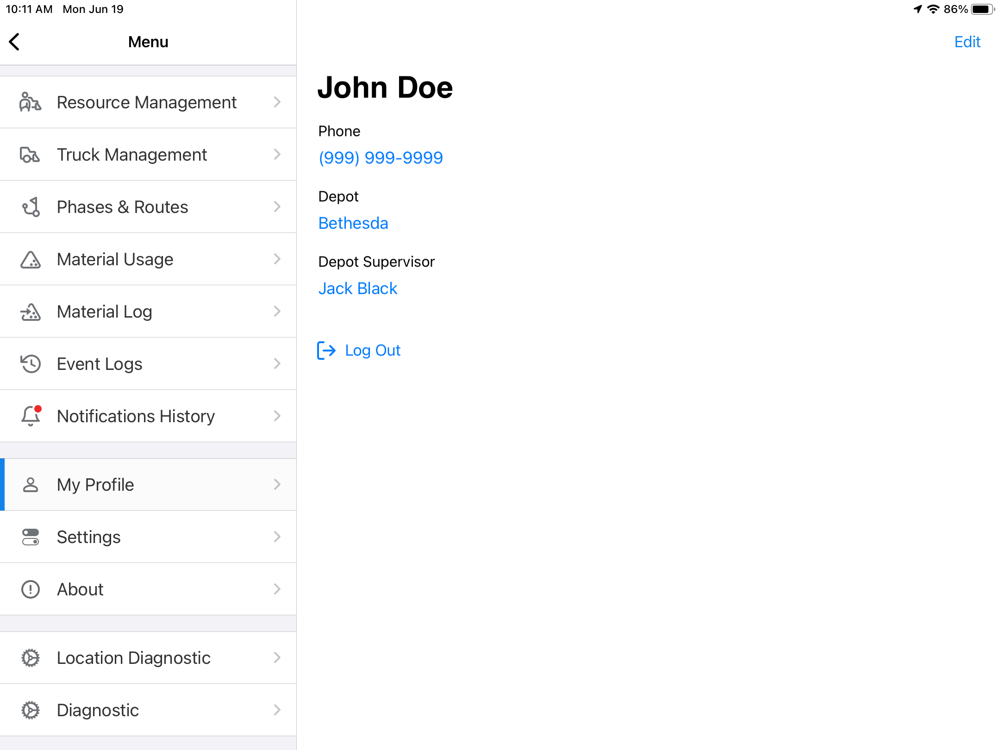
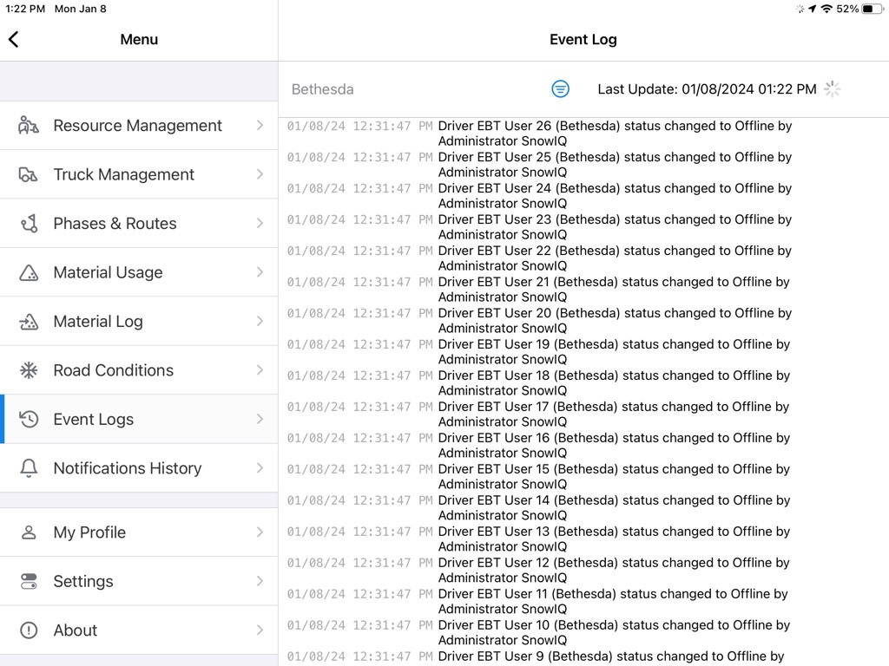
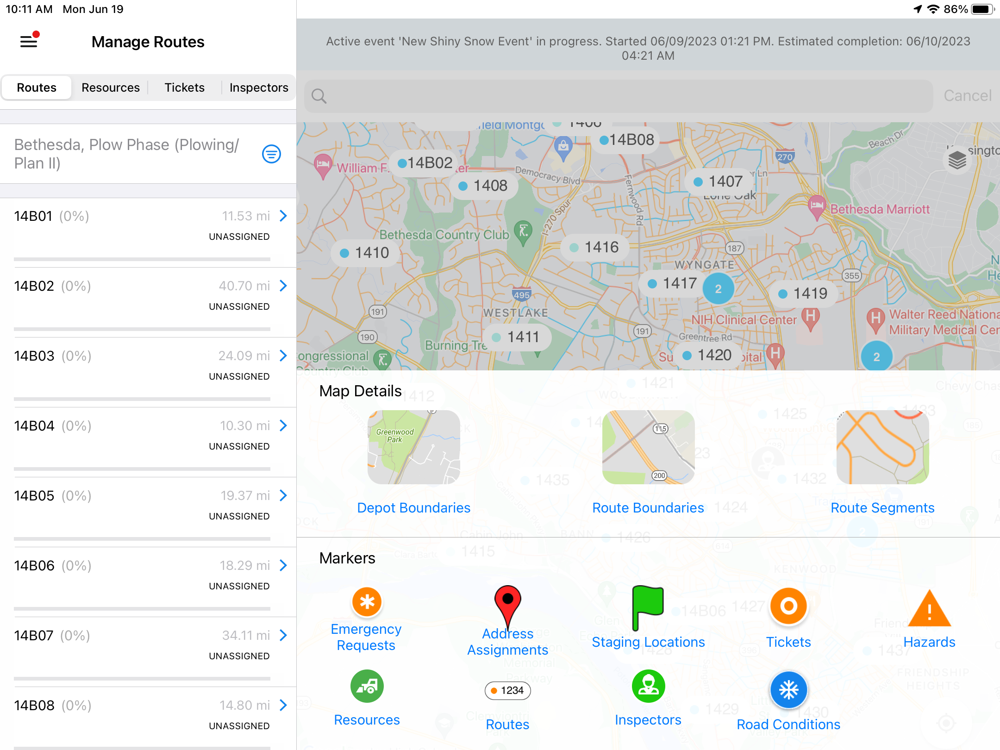

<section id="Login-and-Navigation" markdown="1">
# Login and Navigation

<section id="Login" markdown="1">
## Login

The login screen below allows a Supervisor user to access the SNOWiQ Supervisor Application. Click the 'Login' button to be re-routed to enter the assigned username and password for the application.

Once logged into the Supervisor App, the Map Monitoring view will be displayed.

**Note:** A Supervisor assigned to a specific depot will only see routes associated with that depot.

</section>

<section id="Navigation" markdown="1">
## Navigation

The diagram below highlights basic navigation controls and map elements of the Supervisor App.

1. Main Menu - Navigate to the Menu and Settings
2. Tabs - Switch between available tabs: Routes, Resources, Tickets, or Inspectors
3. Weather widget - View weather conditions automatically updated based on location
4. Filter options - Filter options based on the selected tab
5. List - View a list of Routes, Resources, Tickets, or Inspectors based on the selected tab and any applied filters
6. My location - View the user's location on the map by selecting the "Find my location on the map" button
7. Map Layers button - Displays a panel to select different map layers (markers or segments displayed on the map)
8. Search bar - Search an address on the map to create address assignments
9. Storm Event banner - Displays active event estimates. Selecting the banner opens the Event Log

<section id="Main-Menu" markdown="1">
### Main Menu

Users can open the Main Menu by selecting the 'Hamburger Menu' icon. From the Main Menu, users can navigate to Resource Management, Truck Management, Phases & Routes, Material Usage, Material Log, Road Conditions, Event Logs, Notification History, My Profile, Settings, and About pages.

</section>

<section id="My-Profile" markdown="1">
#### My Profile

Users can view their profile by selecting 'My Profile' from the menu. The profile displays the user's phone number, depot, and Depot Supervisor. A user can edit their profile by selecting 'Edit' in the top right corner, as shown below. This allows the user to edit their information, including name, phone number, and email. The 'Log Out' option is also available on this screen.

</section>

<section id="About" markdown="1">
#### About

Displays the current version of the app.
</section>

<section id="Event-Log" markdown="1">
#### Event Log

The Event Log allows a Supervisor to view user actions and their timestamps for the current active Event. The log displays the time the action occurred in the system, what the action was, and who performed the action (username or system). Actions may include creating an Assignment or activating a new Phase for a Depot.

</section>

<section id="Map-Layers" markdown="1">
### Map Layers

A user can access the Map Layers panel by pressing the Map Layers icon on the map (the stack of layers icon, item 7 in the diagram above). By selecting elements in the panel, a user can specify the markers or segments to be displayed on the map, based on any filters selected in the left-hand panel.

</section>

<section id="Clusters" markdown="1">
### Clusters

On the Map Monitoring view, when a user zooms out, nearby markers are grouped into numbered markers called 'clusters' to de-clutter the map. Selecting a cluster zooms in on that area and displays the separate markers on the map.
</section>
</section>
</section>
