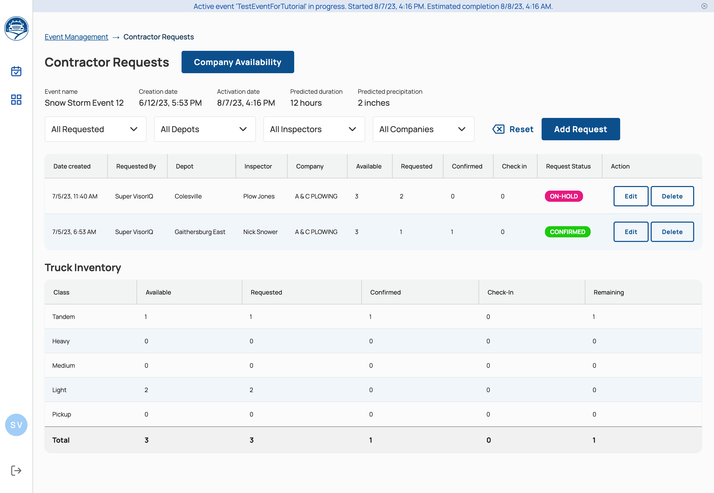
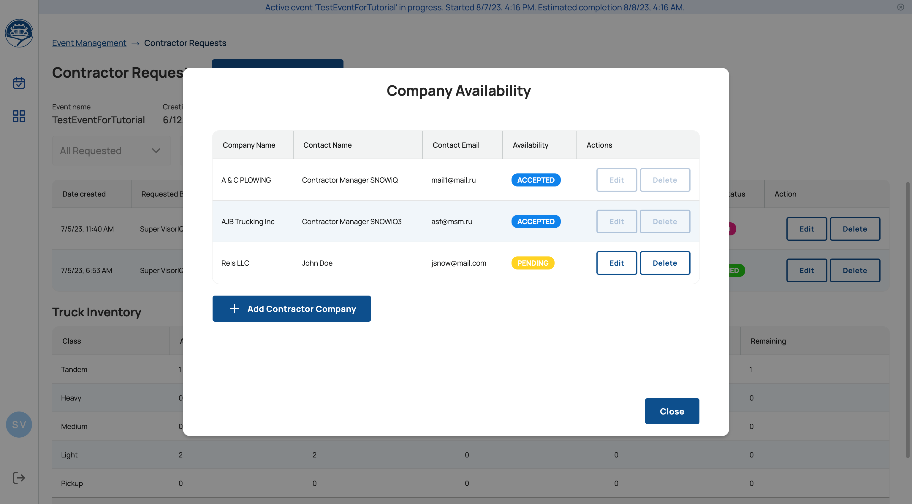
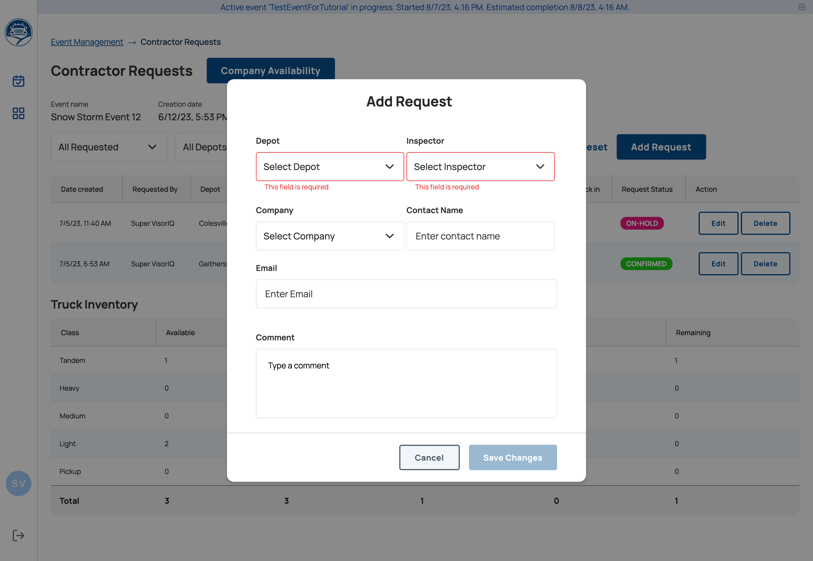
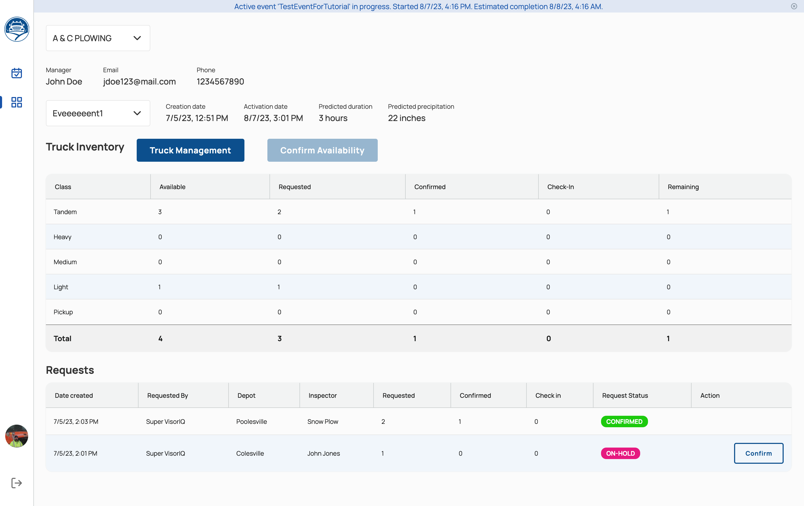
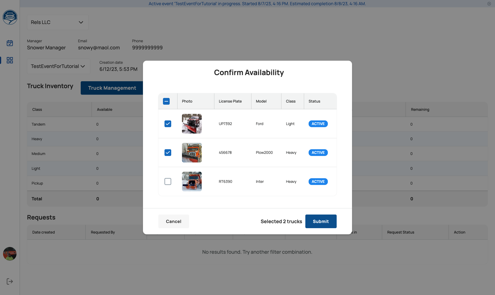
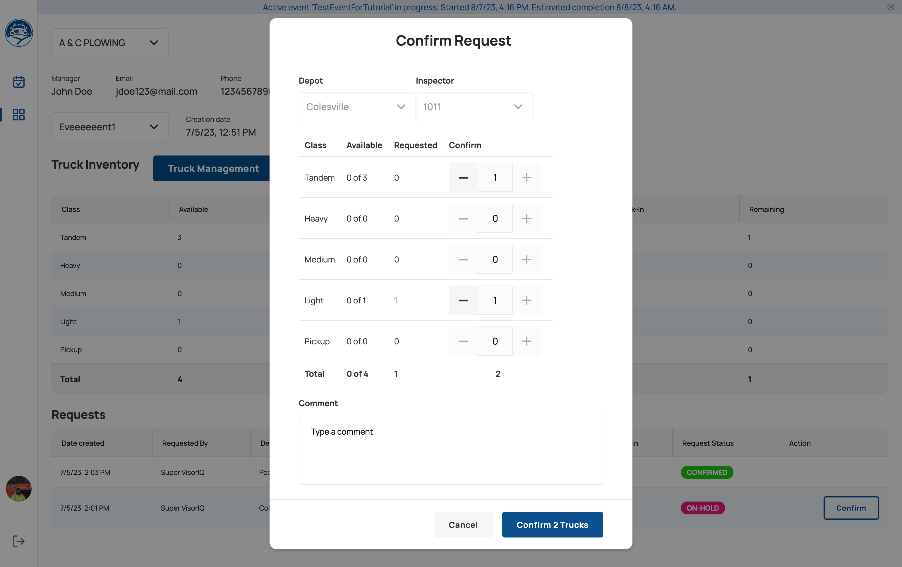

# Contractor Request

## Overview

Contractor companies supply additional trucks and drivers for a snowstorm event. Bringing a contractor on board is a multi-step process shared between the SNOWiQ team (Admins and Supervisors) and the contractor company's **Contractor Manager**. The steps hand off between parties, so each party is notified or can see on screen when it is their turn to act.

| Step | Who | Where | What happens |
|:-----|:----|:------|:-------------|
| 1. Create the event | Admin | Event Management | A snowstorm event is created. Contractor requests are always tied to a specific event. |
| 2. Add a contractor company | Admin or Supervisor | Contractor Requests > Company Availability | The company is added to the event, and its Contractor Manager receives an email asking for truck availability. |
| 3. Confirm truck availability | Contractor Manager | Contractors page (link in the email) | The Contractor Manager reviews and updates the company's trucks in Truck Management, then selects **Confirm Availability**. The number of available trucks by class appears in the event's Truck Inventory. |
| 4. Request specific trucks | Supervisor | Contractor Requests > Add Request | The Supervisor requests a number of trucks by class from a company for a specific depot and inspector. The request is created with the **On-Hold** status. |
| 5. Confirm the request | Contractor Manager | Contractors page > Requests | The Contractor Manager selects **Confirm** on the request. Its status changes to **Confirmed**. |
| 6. Check in | Contractor drivers and Supervisor | Driver App and Supervisor App | Contractor drivers log in to the Driver App and submit a check-in request, which a Supervisor confirms in [Resource Management](sa-resource-management.html). Checked-in trucks are counted in the Check-in column. |

### Tracking progress

Both the Contractor Requests page and the Contractors page show a **Truck Inventory** table for the event, broken down by truck class (Tandem, Heavy, Medium, Light, Pickup):

| Column | Meaning |
|:-------|:--------|
| Available | Trucks the company has confirmed as available for the event (step 3). |
| Requested | Trucks requested by Supervisors (step 4). |
| Confirmed | Requested trucks confirmed by the Contractor Manager (step 5). |
| Check-in | Confirmed trucks that have checked in for the event (step 6). |
| Remaining | Confirmed trucks that have not yet checked in. |

The **Request Status** column shows where each truck-specific request stands:

| Status | Meaning |
|:-------|:--------|
| On-Hold | The request has been sent and is waiting for the Contractor Manager to confirm it. |
| Confirmed | The Contractor Manager has confirmed the request. |

The sections below describe each step in detail.

## Contractor Companies Management

After a snowstorm event has been created, Admins and Supervisors can add contractor companies to support the event.

To access the Contractor Companies Management page, go to **Main Menu > Administration > Event > Requests**.

Only Admins and Supervisors have access to this page.

{: .width-xl}{: data-lightbox="1"}

### Add a Company to an Event

To add a contractor company, click **Company Availability > Add Contractor Company**.

{: .width-xl}{: data-lightbox="1"}

Fill out the form and click the Save Changes button.

The company will be added to the event and its Contractor Manager will receive an email notification requesting information on a truck's availability.

### Add a Truck Specific Request

Supervisors can send truck-specific requests to contractor companies.  

To do so click on the **Add Request** button, then fill out the form which specifies company and amount of trucks by class.

{: .width-xl}{: data-lightbox="1"}

## Contractors Menu

After a Supervisor has added a contractor company to support an upcoming snowstorm event, the Contractor Manager will receive an email notification asking to first update and confirm truck availability.

After clicking a link provided in the request email, the Contractor Manager user will access Contractors page.

{: .width-xl}{: data-lightbox="1"}

This page is designed for Contractor Managers, but can also be accessed by a Supervisor on a manager's behalf.

This page can also be accessed under **Main Menu > Administration > Contractors**.

### Confirm Truck Availability

To confirm truck availability, a Contractor Manager needs to first review and update all the company trucks existing in the truck management module of the system.

{: .width-xl}{: data-lightbox="1"}

After truck availability is submitted, the Supervisor will see that the company has verified availability.

### Confirm a Request

Lastly, the Contractor Manager must provide confirmation of a truck specific request from the Supervisor.

{: .width-xl}{: data-lightbox="1"}

Once confirmed by the Contractor Manager, the Supervisor will see the request status change to Confirmed.
