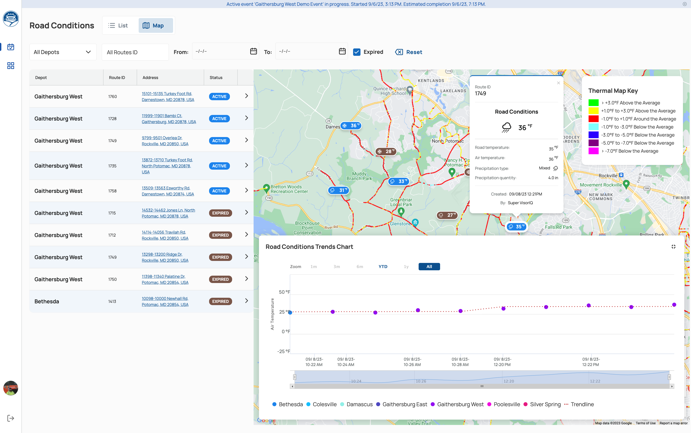

# Road Conditions

A Road Condition provides information on Road Surface Temperature and Precipitation details at a specific location of the service area.

All the Road Conditions are reported by Supervisors or Inspectors using the Supervisor App.

## Road Conditions Page

The Road Conditions page is accessible through the main menu of the Web Portal and contains all reported conditions.

{: data-lightbox="1"}

The road conditions page can present items in two modes: List and List + Map. To change the mode, click on the switch in the upper left corner of the screen.

The list can be filtered and sorted by Depot, Route ID, and time frame. The user can also show/hide expired conditions by clicking the "Expired" checkbox.

## Thermal Map

In Map mode, the Road Conditions page displays an additional Thermal Map layer. The Thermal Map colors the route segments of the service area to show how the road surface temperature on each segment typically compares to the average for the area.

**Note:** The Thermal Map is a statistical heatmap. It does **not** show current, real-time temperatures and does not reflect temperature changes as the storm progresses. The colors show where roads tend to be warmer or colder than average. For actual current conditions, use the Road Condition markers reported by Supervisors and Inspectors, and the Trends Chart described below.

### Reading the Thermal Map

Each color represents how many degrees a segment is above or below the average, not an absolute temperature. The Thermal Map Key in the upper right corner of the map shows the brackets:

| Color | Temperature compared to the average |
|:------|:------------------------------------|
| Green | More than 3.0°F above the average |
| Yellow | 1.0°F to 3.0°F above the average |
| Red | Within 1.0°F of the average |
| Light blue | 1.0°F to 3.0°F below the average |
| Blue | 3.0°F to 5.0°F below the average |
| Purple | 5.0°F to 7.0°F below the average |
| Magenta | More than 7.0°F below the average |

For example, if road conditions reported across the area are around 33°F, segments shown in blue (3.0°F to 5.0°F below the average) are likely to already be below freezing.

### Using the Thermal Map

The Thermal Map helps with planning and prioritization:

* **Identify cold spots** - Segments shown in blue, purple, or magenta are consistently colder than their surroundings (for example, bridges, overpasses, shaded or low-lying roads). These segments are more likely to freeze first and stay icy longer.
* **Prioritize treatment** - Use cold spots to decide which routes or segments to salt first, or to plan additional passes.
* **Interpret reported conditions** - Combine the Thermal Map with reported Road Conditions. A single reported temperature applies to one location; the Thermal Map shows how nearby segments are likely to differ from it.

## Trends Chart

The map also contains the Road Conditions Trends Chart module in the right lower part of the screen.

The Road Conditions Trends Chart is a graph representing temperature changes.

The Trends Chart can be shown or hidden by selecting the plus icon (+) in the right part of the module.

It can be also customized by sliding the time frame bracket.

## Road Conditions Expiration

All Road Conditions automatically expire within 1 hour after being reported.

Upon expiration, the status of a condition is changed from 'Active' to 'Expired', and the marker color is changed from blue to brown.
