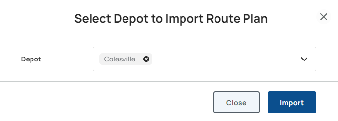

<section id="Route-Management" markdown="1">
# Route Management

On the Route Plans page, an Admin user can view the currently used geo-location data for route lines and boundaries for each depot, a timestamp, and its current status. Additionally, the Admin can Upload Plan Files to update the data. Each event in the system is associated with a specific Route Plan version number. 

{: .width-xl}{: data-lightbox="1"}

<section id="Import-Route-Plans" markdown="1">
## Import Route Plans

An Admin can upload the geo-location data by doing the following:

* Select the blue '+ Import Route Plan' button at the top of the Route Plans page.
* The system will display a prompt. Do the following:

{: .width-md}{: data-lightbox="2"}

* Select the Depot the geo-location data belongs to. The uploaded file specifies the routes for that depot and replaces its previous route plan.
* Select 'Import'
* Once the upload is complete, the Admin will be able to review the depot in the Route Plans list to see if the new Route Plan upload is labeled as New.
</section>

<section id="Viewing-Archived-Routes" markdown="1">
## Viewing Archived Routes

Route Plans are automatically archived when new Route Plan files are uploaded. An Admin can view all the previous Route Plan versions and their upload timestamps by selecting the name of the Depot in bold (for example, selecting 'Gaithersburg East' expands an accordion-style list showing its history and previously archived files).
</section>

<section id="Preview-Routes" markdown="1">
## Preview Routes

Select the Preview button to preview boundaries, routes segments, coordinates and other details.

{: .width-xl}{: data-lightbox="3"}

</section>

